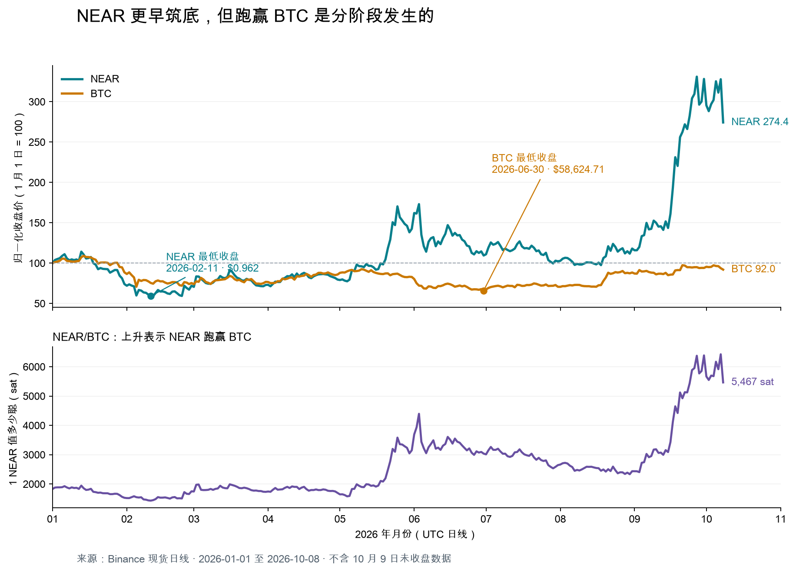

# 熊市强势币识别与买入跟踪模板：NEAR 与 BTC 的相对强弱案例

创建于 2026-10-09

> 研究目标：把“有些币比 BTC 更早触底，之后涨得更快”的观察，拆成可以事前记录、持续跟踪、接受反例检验的研究流程。  
> 数据边界：2026-10-09 采集；研究样本为 2026-01-01 至 2026-10-08 的完整 UTC 日线，使用 2025 年 12 月历史数据作为指标预热；排除 10 月 9 日未收盘数据。本文所有行情日期均为 UTC。  
> 适用场景：流动性足够的现货币种、中期结构跟踪。本文为历史案例和研究模板，不构成当前 NEAR 的买入建议，也没有验证策略胜率。

## 一、结论：提前抗跌有筛选价值，买入还需要触发条件和失效位置

**NEAR 的案例支持这条逻辑：某个币与 BTC 同期见到阶段低点后，BTC 继续破底，它却不再创新低，随后对 BTC 转强；市场环境改善时，它有机会出现更大的涨幅。**2026 年 2 月 6 日两者同日见到阶段低点，此后 BTC 又小幅跌破，NEAR 的低点却抬高了一倍多——关键是这种分化，而不是 NEAR 单方面“提前触底”。这个案例只能说明该路径确实发生过，不能证明沿着这条路径筛选就能稳定获利。

把整个判断拆成三个问题：

| 问题 | 要寻找的证据 | 不能替代的判断 |
|---|---|---|
| 值不值得关注？ | 低点抬高；BTC 再跌时不跟随破底；币/BTC 汇率改善 | 抗跌不等于马上上涨 |
| 何时出现候选入场？ | 事前标出的区间被突破；回踩未破坏结构；随后重新转强 | 放量大阳线不等于低风险买点 |
| 错了怎么办？ | 入场前写出失效位置、执行方式、风险预算 | 强项目也可能出现大幅回撤 |

**本文优先研究“第一次有效突破后的回踩再转强”。**它并不保证买得最低，但通常更容易明确：买入基于什么事实，以及价格走到哪里意味着判断失效。不回踩直接上涨时，这种等待方式可能错过行情。

对“熊市”的使用也要克制：本文指的是样本中的 BTC 下跌、反复探底或尚未恢复上升结构的阶段，不把 2026 年所有日期统称为熊市。今后每个候选都要记录观察当日的 BTC 状态，不能在涨完之后倒推环境标签。

## 二、数据与无前视原则：把事后复盘和当时可执行的判断分开

### 2.1 数据源、字段与计算口径

本案例使用币安现货 `NEARUSDT`、`BTCUSDT` 和 `NEARBTC` 日线。USDT 交易对用于绝对价格和成交活动分析；NEAR/BTC 用于判断 NEAR 相对 BTC 的强弱。[币安官方 K 线接口说明](https://developers.binance.com/docs/binance-spot-api-docs/rest-api/market-data-endpoints)

| 指标 | 本文口径 |
|---|---|
| 盘中低点 | 完整日线的最低价 low |
| 最低收盘价 | 完整日线的收盘价 close |
| 区间收益率 | 期末收盘价 ÷ 期初收盘价 − 1；整月以此前月末收盘价为起点 |
| 现货成交量 | 基础币数量，例如 NEARUSDT 中成交的 NEAR 枚数 |
| 现货成交额 | 计价币金额，例如 NEARUSDT 中成交的 USDT 金额 |
| 相对成交量 | 当日成交币数 ÷ 此前 20 个完整交易日成交币数的平均值；分母不含当日 |
| 相对强弱 | 币/BTC 汇率的方向、区间与高低点；不是 RSI |
| 回撤 | 明确指定的高点到后续低点的跌幅；不自动等于某笔交易的实际亏损 |

相对强弱比较的是两个资产的表现关系。USDT 价格上涨而币/BTC 下跌，意味着币虽然涨了，却跑输了 BTC。[Fidelity：相对强弱比较](https://www.fidelity.com/learning-center/trading-investing/technical-analysis/technical-indicator-guide/relative-strength-comparison)

数据保存在 [参考数据目录](强势币跟踪参考数据-2026-10-09/)，包括 [NEARUSDT 日线](强势币跟踪参考数据-2026-10-09/NEARUSDT-1d.json)、[BTCUSDT 日线](强势币跟踪参考数据-2026-10-09/BTCUSDT-1d.json)、[NEARBTC 日线](强势币跟踪参考数据-2026-10-09/NEARBTC-1d.json)、[采集与边界说明](强势币跟踪参考数据-2026-10-09/snapshot.json)和[核验结果](强势币跟踪参考数据-2026-10-09/evidence.json)。后续应保留这些快照，避免滚动 API 返回范围变化后无法复现。

### 2.2 四条必须遵守的时间规则

1. **观察当天，只能使用当时已经公布或已经收盘的信息。**10 月的收入、ETF 或治理消息，不能解释成 2 月交易者已经掌握的事实。
2. **信号依赖当天收盘时，最早在下一根日线执行。**日线在次日 00:00 UTC 结束；回测可用下一根开盘价作为理想化执行参考，实际还要考虑延迟和滑点。
3. **局部低点需要后续行情才能确认。**低点发生日期与“当时已经可以识别出低点”的日期不同。记录时必须区分。
4. **先确定规则，再记录结果。**区间边界、量能参照、相对强弱条件、止损和观察期限不得在看到后续涨跌后随意调整。

“NEAR 年内最低点比 BTC 早 145 天”属于事后总结。2 月 6 日当晚，没人能仅凭当日行情确认那就是全年最低点；截至 10 月 8 日识别出的年内低点，也不保证未来不被跌破。

## 三、NEAR 实证：同期低点后分化成立，但后续并非一直跑赢 BTC

### 3.1 先比较低点，再比较阶段表现

| 低点口径 | NEAR | BTC |
|---|---|---|
| 2 月阶段盘中低点 | 2 月 6 日，**0.841 USDT** | 2 月 6 日，**60,000.00 USDT** |
| 年内盘中最低价 | 2 月 6 日，**0.841 USDT** | 7 月 1 日，**57,800.19 USDT** |
| 年内最低收盘价 | 2 月 11 日，**0.962 USDT** | 6 月 30 日，**58,624.71 USDT** |

两者的 2 月阶段低点出现在同一天。此后 BTC 又比 2 月低点多跌约 **3.7%**，因此按年内盘中低点算，NEAR 比 BTC 早 **145 天**；按最低收盘价算，早 **139 天**。这个天数来自 BTC 后来的小幅破底，不代表 NEAR 在 BTC 下跌途中独自先见底。上述比较仅覆盖本文样本区间。[本地核验数据](强势币跟踪参考数据-2026-10-09/evidence.json)

更有信息量的比较是 BTC 破底的日子：

| 日期 | BTC 当日 | NEAR 当日最低 | 相对 NEAR 2 月低点 |
|---|---|---:|---:|
| 6 月 5 日 | 首次跌破 2 月低点，最低 59,130.91 | **1.825 USDT** | 约 **+117%** |
| 7 月 1 日 | 刷新样本内最低点 57,800.19 | **1.723 USDT** | 约 **+105%** |

NEAR 并未完全摆脱市场波动，但价格底部已经明显抬高。

| 阶段 | NEAR 收益 | BTC 收益 | 这段行情说明什么 |
|---|---:|---:|---|
| 2 月 11 日收盘至 4 月 30 日收盘 | **+34.8%** | +13.8% | NEAR 先修复 |
| 5 月：4 月 30 日至 5 月 31 日收盘 | **+78.9%** | −3.5% | NEAR 出现独立上涨 |
| 6 月：5 月 31 日至 6 月 30 日收盘 | **−23.2%** | −20.4% | 两者回落，NEAR 跌幅更大 |
| 7—8 月：6 月 30 日至 8 月 31 日收盘 | +7.9% | **+34.0%** | BTC 修复更快，NEAR 落后 |
| 9 月：8 月 31 日至 9 月 30 日收盘 | **+177.9%** | +6.4% | NEAR 再次明显跑赢 |

这些区间用于描述阶段，不是一笔从头持有到尾的交易。尤其不能忽略 6 月至 8 月的调整，只保留 5 月和 9 月上涨来证明模式有效。[NEAR 与 BTC 原始日线及计算依据](强势币跟踪参考数据-2026-10-09/evidence.json)



### 3.2 低点序列显示的是抬高的价格结构

| 日期 | NEAR 当日最低价，USDT | 复盘意义 |
|---|---:|---|
| 2 月 6 日 | 0.841 | 样本内盘中最低点 |
| 2 月 12 日 | 0.934 | 第一次回落未跌破前低 |
| 2 月 24 日 | 0.953 | 再次回落，低位继续抬高 |
| 3 月 29 日 | 1.129 | 再次回落仍高于前两次低位 |
| 5 月 4 日 | 1.245 | 5 月突破前的较高低位 |
| 7 月 1 日 | 1.723 | BTC 创新低时，NEAR 未跟随破底 |

这是为讲解选取的关键日期，不是一个已经运行的自动拐点识别算法，也不是所有回调的完整列表。今后实际跟踪时，应在当日记录“目前看到的回调低位”和确认条件，不能把事后挑出的漂亮低点序列直接当作买点。[NEAR 原始日线](强势币跟踪参考数据-2026-10-09/NEARUSDT-1d.json)

## 四、怎样理解强势：证据可以叠加，资金身份不能猜

| 观察 | 合理解释 | 尚不能得出的结论 |
|---|---|---|
| 多次回落不再创新低 | 更低价格暂未被市场持续接受 | 一定是机构吸筹 |
| BTC 创新低，该币低点明显抬高 | 相对抗跌，可能存在自身供需改善 | 此后不受 BTC 下跌影响 |
| 币/BTC 开始抬高并突破整理 | 强势包含超越 BTC 的部分 | 已确认长期领涨地位 |
| 突破时成交币数增加 | 更多交易伴随价格向上移动 | 成交额全是新增资金流入 |
| 回踩时量缩、结构仍守住 | 卖出活动暂未破坏此前突破 | 后续不会出现新的卖压 |

可能的机制是：项目自身需求、供应约束或预期先改善，使它在市场仍弱时停止创新低；市场风险偏好随后改善，价格弹性进一步释放。**这是可以检验的机制解释，不是价格图已经证明的资金来源。**

基本面适合作为独立证据：例如真实使用量、收入和代币需求是否同步改善。必须使用候选出现时已经可得的数据，并分别记录手续费、协议收入、回购提案与实际执行。即使后来 NEAR 的业务表现改善，也不能倒推所有早期上涨都由这些后来数据驱动。

## 五、候选规则：从观察到触发，始终保留“未满足”状态

以下是一个便于手工跟踪的候选流程，**不是经多币、多周期检验的交易系统**。其中任何数值阈值都只是待检验参数，不能用 NEAR 这一例反复优化到最好看。

| 状态 | 当时需要记录的事实 | 下一步条件 |
|---|---|---|
| 观察 | 已停止持续创新低；出现较高回调低位；币/BTC 停止恶化 | 画出有历史成交支持的整理区间，冻结边界和画法 |
| 等待突破 | 区间上沿、下沿、BTC 环境已记录 | 完整日线收于上沿之上，并满足预先写好的相对强弱条件 |
| 等待回踩 | 突破已发生；记录量能、涨幅及距离支撑多远 | 首次回踩未触及预设失效条件；仍要等待重新转强 |
| 候选触发 | 例如日线收盘重新超过前一日最高价，且此前条件仍成立 | 收盘确认后，最早下一根执行；入场前重新检查价差和仓位 |
| 失效 | 跌破预设结构；币/BTC 转弱达到预设条件；事件风险改变；超过最长等待期限仍未触发 | 按事先规则退出或移出候选，并保留失败记录 |
| 筛掉 | 进入观察时即不满足范围、流动性或数据要求 | 记录原因后移出，不删除记录 |

为了让规则可复核，需要在每个币的记录中把抽象词换成具体定义。例如：

- “突破”：日线收盘价超过提前写好的区间上沿，而不是只在盘中触及。
- “币/BTC 转强”：可以选择收盘超过事前指定的相对价格区间上沿；若使用其他条件，要写清并保持一致。
- “放量”：可以研究相对成交量是否超过 **1.5 倍**，但该阈值没有在本文验证。分母始终为此前 20 日，不含信号当日。
- “回踩守住”：提前选择允许的下探范围、按盘中价还是收盘价判断，以及最长等待天数。不能价格跌穿后再扩大容忍区间。
- “缩量”：事前选定与突破日或此前均量比较，并保留数值；不应等看到结果后切换参照。

**如果尚未写出具体区间和规则，就停留在观察状态。**不要用“看起来很强”代替可重复的条件。突破后回到原区间也可能造成亏损，支撑与阻力分析必须与执行和退出规则一起使用。[Schwab：波段交易中的入场与退出](https://www.schwab.com/learn/story/ins-and-outs-swing-trade)

## 六、NEAR 5 月案例：同一条触发规则，先后触发两次

### 6.1 逐步还原当时能看见什么

| 时间点 | 当时可见的数据 | 允许形成的判断 |
|---|---|---|
| 5 月 8 日收盘 | NEAR 收 **1.598**，超过此前 60 日最高收盘 **1.490**；成交币数为此前 20 日均量的约 **2.59 倍**；NEAR/BTC 收 **1993 sat**，仅比此前 60 日最高收盘 **1992 sat** 高 1 sat | 出现值得跟踪的突破结构；相对 BTC 的突破非常勉强，应记为“弱确认”；不能预知后续回踩深度 |
| 5 月 9—11 日 | 三天收盘均低于前一日最高价；最低 **1.510**，比 5 月 8 日收盘低约 **5.5%** | 第一次浅回踩，结构未破坏 |
| 5 月 12 日收盘 | 收 **1.609**，超过 5 月 11 日最高价 **1.575**；量比约 **2.41** | **按“收盘重新超过前一日最高价”，这是突破后的第一次候选触发** |
| 5 月 13 日 | 开盘 **1.609**（第一次触发的模拟入场参考），盘中创新高 **1.692**，量比约 **2.45** | 行情继续上冲，但随后回落 |
| 5 月 14—17 日 | 回落到 **1.469**：比 5 月 13 日高点低约 **13.2%**，比第一次模拟入场价低约 **8.7%**；5 月 17 日量比约 **0.64** | 第一次触发的持仓承受明显浮亏；结果取决于止损放在哪里 |
| 5 月 18 日收盘 | 收 **1.626**，超过 5 月 17 日最高价 **1.560**；当日量比约 **1.19** | 第二次满足同一触发条件，并非再次放量至 1.5 倍 |
| 5 月 19 日开盘 | 开盘约 **1.626** | 第二次触发的模拟入场参考，须另计成本 |

数据来源：[NEARUSDT 原始日线](强势币跟踪参考数据-2026-10-09/NEARUSDT-1d.json)、[NEARBTC 原始日线](强势币跟踪参考数据-2026-10-09/NEARBTC-1d.json)、[核验结果](强势币跟踪参考数据-2026-10-09/evidence.json)。

**两次触发都必须登记，不能只保留结果更好的 5 月 18 日。**第一次触发的结局取决于事前写好的止损：

| 第一次触发的止损设定 | 5 月 14—17 日的结果 |
|---|---|
| 1.450，位于 5 月 8 日突破日最低 1.455 下方 | 未触发，最大浮亏约 8.7%，之后回到盈利 |
| 1.500，位于 5 月 9—11 日回踩低点 1.510 下方 | 5 月 16 日盘中最低 1.479，止损被触发 |

若研究者只想把“回到突破位附近”的回落算作回踩（例如收盘或盘中价距 1.490 不超过某个百分比），必须在 5 月 8 日之前写下这条定义，这样 5 月 9—11 日的浅回落才可以不算。本文没有这样的事前记录，因此不能事后把 5 月 12 日排除掉。

**也不能假定自己在 5 月 17 日的 1.469 买到低点，同时又利用 5 月 18 日收盘才出现的确认。**提前买回踩与确认后买转强是两种不同策略，入场价格、失效风险和结果必须分别记录。

1.490 是此前最高**收盘价**，不是最高盘中价。5 月 17 日最低 1.469 略低于该水平，不能把这个案例描述成“完全没有跌回突破位”。若研究允许盘中试探平台区，应事前写出容忍范围和失效位置；如果规则原本要求盘中严格守住 1.490，本例就已经不符合条件，不能事后放宽。

### 6.2 这个位置为什么值得研究

5 月 18 日收盘之后，研究者已经看到：前期低位抬高、放量上行、两段回落，以及回落后的重新转强。由此可以提出一笔能够说明理由的候选交易，并围绕回踩低点设计失效条件。但要记住，同一规则在 6 天前已经触发过一次，那一次的结局取决于止损位置。

本报告没有证据证明研究者在 5 月 8 日之前已经冻结同一套区间和规则。因此，这里是**事后按时间顺序还原可见信息的案例**，不是已经完成的前瞻实盘验证。

[核验结果](强势币跟踪参考数据-2026-10-09/evidence.json)中还记录了 9 月 4 日、14 日、16 日的量价数据，本文未展开分析。9 月行情可以用同一套冻结规则补做一次检验，但样本仍是 NEAR 本身，不能算作独立验证。

“成功结构”只指后续价格确实走出上涨，不表示这里已经得出完整策略盈利：如果没有提前确定退出方式，同一入场可以产生不同收益。触发条件也不能单独使用，必须连同前面的观察、突破、回踩条件一起评估。

## 七、必须保留的反例：很强的量价信号之后也可能急跌

6 月 3 日，NEAR 收盘 **2.817 USDT**，创此前 60 日收盘新高；NEAR/BTC 也创阶段新高，成交币数约为此前 20 日均量的 **1.97 倍**。这些表面上都是强势证据。

但到 6 月 7 日，NEAR 盘中最低已到 **1.813 USDT**，相对 6 月 3 日收盘下跌约 **35.6%**。进一步看，6 月盘中高点 **3.087** 至 8 月低点 **1.538**，跌幅约 **50.2%**。[原始行情和核验结果](强势币跟踪参考数据-2026-10-09/evidence.json)

| 容易误判的地方 | 这个反例的作用 |
|---|---|
| 放量、突破、币/BTC 创新高同时出现就可以买 | 同样的信号，出现在长期整理后和连续上涨后，风险距离不同 |
| BTC 破底时不跟随，就能一直持有 | 底部抬高之后仍可出现约一半的价格回撤 |
| BTC 一旦上涨，该币一定涨得更快 | 7—8 月 NEAR 仅约 +7.9%，BTC 约 +34.0% |
| 项目基本面好就不必设失效条件 | 价格结构与交易期限仍然决定如何控制损失 |

这里的跌幅是指定价位之间的价格变化，不是已执行止损策略的实际损失。6 月 3 日也不是本文“首次突破后回踩转强”规则已经被完整触发的证明；它用来反驳的是更粗糙的规则——**只要放量创新高就买，或者认为底部先抬高就意味着一路领涨。**

## 八、先计算风险，再决定仓位

以下仅使用 5 月第二次触发（5 月 18 日收盘）的历史价位做计算，不是当前 NEAR 下单建议：

| 项目 | 示例 |
|---|---:|
| 模拟入场价 | 1.626 USDT |
| 假设止损价 | 1.450 USDT，位于回踩低位下方 |
| 每枚计划价格风险 | 1.626 − 1.450 = **0.176 USDT** |
| 假设往返成本 | 入场价的 0.3%（买卖手续费加滑点）≈ **0.0049 USDT** |
| 每枚计划总风险 | 0.176 + 0.0049 ≈ **0.1809 USDT** |
| 计划总风险比例 | 0.1809 ÷ 1.626 ≈ **11.12%**（不计成本时为 10.82%） |
| 单笔账户风险预算 | 账户净权益的 **0.5%** |
| 对应现货仓位占比 | 0.5% ÷ 11.12% ≈ **4.49%**（不计成本时为 4.62%） |

通用公式：

    风险预算金额 = 账户净权益 × 单笔允许风险比例
    可买数量 = 风险预算金额 ÷（入场价 − 止损价 + 每枚预估交易成本）
    仓位金额 = min(可买数量 × 入场价, 单币仓位上限)

单币仓位上限需要事前设定。止损距离很近时，公式算出的仓位可能大到不合理，甚至超过账户净权益，此时按上限截断，不能因为止损近就放大仓位。

预估交易成本应覆盖买卖手续费、买入滑点和止损卖出滑点。若止损采用收盘确认，实际成交可能离设定价很远，不能把设定价当成保证成交价；应按预计执行情景估算风险。跳空、流动性骤降、交易所故障仍可能使实际亏损超过预算。

止损位置应来自交易逻辑，不能为了买入更大仓位而挤到正常波动内部。多个候选也可能同时受 BTC 下跌影响，因此单笔预算之外还要记录组合总风险。本文没有提供杠杆方案。

## 九、全市场候选登记：不要只保存后来涨得好的币

每次筛选时先冻结可研究币种范围，例如“当日已经上线、历史数据足够、现货深度达到本人预设要求的币种”。范围与门槛要提前记录，不能等结果出现后只留下 NEAR 这样的赢家。

同一张候选表应包含进入观察、没有触发、触发后失败、因条件不符被筛掉的对象：

| 首次观察时间 UTC | 币种/交易对 | 当时 BTC 状态 | 当时可得证据与链接 | 规则冻结时间/版本 | 当前状态 | 未通过或失效原因 | 下次复核时间 | 结果状态 |
|---|---|---|---|---|---|---|---|---|
| 待填写 | 待填写 | 下跌/区间/上升，附依据 | 只填当时已有数据 | 待填写 | 观察/等待突破/等待回踩/候选触发/失效/筛掉 | 待填写或不适用 | 待填写 | 待观察/已结束 |

保留旧记录，以追加方式写新的判断。例如“原判断：相对强弱改善；新事实：跌回相对价格区间；因此失效”，而不是直接把原判断删除。这样才能区分规则失效、执行偏差和研究者后来修改标准。

实际登记见 [强势币候选登记表](强势币候选登记表.md)。

## 十、可直接复制到新币研报的 Markdown 模板

复制下方模板，每个币独立填写。未获取的数据写“未获取：原因”，不填零；未满足条件写“未满足”；观察期限未结束写“待观察”。

```markdown
# [币种] 强势结构跟踪：相对 BTC 的抗跌、突破与回踩

创建于 YYYY-MM-DD

## 1. 研究卡片

- 首次观察时间（UTC）：
- 最近更新时间（UTC）：
- 数据截止时间（UTC）：
- 现货交易对、交易所、链及合约地址（如适用）：
- 研究窗口与历史预热窗口：
- 进入观察的原因：
- 当前状态：观察 / 等待突破 / 等待回踩 / 候选触发 / 失效 / 筛掉。触发后的表现记在第 7 节。
- 核心假设（一句话）：
- 当前最重要的反证：
- 规则冻结时间与版本：
- 预计下次复核时间：

## 2. 当时的 BTC 与市场环境

| 项目 | 当时可见事实 | 来源/数据截止时间 |
|---|---|---|
| BTC 下跌、区间还是上升 | 填写判断标准及具体价位 | |
| BTC 最近一次较低低点/反弹高点 | 日期与价格 | |
| 该币在同一轮 BTC 下跌中的表现 | 同时间窗口收益和低点比较 | |
| 市场与行业事件 | 只用当时已公布信息 | |

## 3. 绝对价格与相对价格结构

| 项目 | 数值、日期与判定 | 来源 |
|---|---|---|
| USDT 价格前低与后续回调低位 | 记录确认时间，区分盘中与收盘 | |
| 整理区间下沿、上沿及画法 | 何时冻结，使用哪些已完成 K 线 | |
| 币/BTC 区间与高低点 | 明确相对强弱条件；不使用 RSI 替代 | |
| BTC 再下跌时是否跟随破底 | 同期对照 | |
| 距离结构失效位 | 百分比与价格 | |
| 目前不符合强势假设的事实 | 不得留作只列利好的报告 | |

没有直接币/BTC 交易对时，可使用同时间戳的币/USDT 收盘价除以 BTC/USDT 收盘价；说明这是合成收盘比值，不冒充真实币/BTC 的盘中高低价。

## 4. 现货成交与执行条件

| 项目 | 观察值与统计窗口 | 解释与局限 |
|---|---|---|
| 基础币成交量 | 枚数 | |
| 计价币成交额 | USDT 等 | 不等于净资金流入 |
| 此前 20 日平均成交量 | 不含信号当日 | |
| 信号日相对成交量 | 当日量 / 此前均量 | |
| 回踩量能 | 预先指定的比较参照 | |
| 买卖价差、可成交深度及下单规模 | 观察时间与订单规模 | |
| 数据缺失、异常放量或交易对迁移 | 说明处理方式 | |

## 5. 基本面与供应：独立核验，不用故事替代价格

| 项目 | 本期 | 可比前期 | 口径、来源、当时发布时间 |
|---|---|---|---|
| 活跃地址/账户与交易笔数 | | | 地址不等于真人；检查机器人与激励 |
| 真实交易金额/业务量 | | | 跨链业务与主链交易分别统计 |
| Fees：用户总费用 | | | 不等于协议收入 |
| Revenue：协议收入 | | | 说明归属方、成本边界和统计方法 |
| 代币价值传递 | | | 分红、回购、销毁、质押激励分别说明 |
| 回购执行 | | | 提案/通过/已执行；实际交易或钱包证据 |
| 流通供应、增发、解锁 | | | 数量、日期、占流通量比例 |
| 流通市值与 FDV | | | 采样时间；两者不得混用 |
| 安全与事件风险 | | | 合约、桥、托管、权限、暂停、重大事件 |

观察窗口统一为完整日；原币收入与美元收入尽量同时记录。未取得证据的解释列为假设，不写成事实。日后新增消息不得回填为早期入场依据。

## 6. 事前交易假设与候选触发

- 区间上沿/下沿：
- 突破条件：
- 相对 BTC 条件：
- 量能条件及参照窗口：
- 回踩允许范围及判断方式（盘中/收盘）：
- 回踩再转强触发条件：
- 最长等待期限及取消条件：
- 收盘确认时间与最早允许执行时间：
- 模拟或实际入场方式、订单有效期：
- 失效位置、止损触发方式与执行方式：
- 退出/止盈/最长持有期限：
- 账户净权益、单笔风险预算、组合总风险：
- 手续费、滑点与成本假设：
- 计算所得数量与现货仓位占比：
- 单币仓位上限；风险距离过近时按上限截断：
- 风险距离过远或流动性不足时的处理：
- 最终状态：未满足 / 候选触发 / 已执行 / 取消。

任何依赖当天收盘的触发，最早下一根执行。若调整规则，记录修改时间、原因和新版本；不要覆盖旧版结果。

## 7. 跟踪结果与 BTC 对照

先写明采用哪种口径：未入场候选从首次观察后的下一根开盘开始；已触发交易从下一根实际/模拟入场开始。两类样本分别统计，不混合比较。

| 检查点 | 已完成周期 | 币种收益 | 同期 BTC 收益 | 超额收益（百分点） | MFE | MAE | 结构/事件变化 | 状态 |
|---|---:|---:|---:|---:|---:|---:|---|---|
| 7 日 | | | | | | | | 待观察 |
| 14 日 | | | | | | | | 待观察 |
| 30 日 | | | | | | | | 待观察 |

- 起始价格、时间与成本口径：
- BTC 对照起始价格与相同时间：
- MFE（最大有利变动）：max(0, 观察段最高价 / 起始价格 − 1)。
- MAE（最大不利变动）：min(0, 观察段最低价 / 起始价格 − 1)，保留负号；可用 -MAE 表示最大亏损幅度。
- 若从日线开盘进入，第 N 日结果取从进入当日起第 N 根完整日线的收盘；不得使用进入前的盘中高低价。
- 超额收益是币种收益减 BTC 收益，不等于币/BTC 本身的收益率。
- 固定观察窗口的 MFE/MAE 与持仓期间 MFE/MAE 分开；退出后仍可继续观察，但不能计入实际持仓表现。
- 未满期限填“待观察”，不得用不足 30 日的数据冒充 30 日结果。

## 8. 结束复盘

- 是否触发；未触发或被筛掉的原因：
- 是否执行；实际成交与假设偏差：
- 实际退出、持仓收益、成本及实现的风险倍数：
- 哪项原假设得到支持：
- 哪项原假设被否定：
- 是否发生临时改规则；影响是什么：
- 本案例能说明什么、不能说明什么：
- 需要放入下一批样本验证的问题：

## 9. 数据来源与快照

- 原始行情、采集时间、日线时区、缺失情况：
- 指标公式与冻结参数：
- 基本面官方来源及发布时间：
- 原始数据与计算结果文件：
- 图表：
```

## 十一、怎样检验这套思路是否真的有效

**下一步不是再找几个涨得好的例子，而是在结果未知时留下完整候选列表。**否则很容易只看到底部先抬高的赢家，忽略同样抗跌却后来补跌、长期横盘或流动性消失的币。

按最小可行方式验证即可：

1. **冻结候选范围和规则。**记录当时已上线的币种、数据要求、区间画法、量能门槛、执行时点、成本和退出规则；避免只使用今天仍活跃的币，遗漏退市或失败项目。
2. **保留全部状态。**把没有触发、突破失败和被筛掉的对象一起保存。不要用“没买到”删除不漂亮的案例。
3. **分开检验筛选和入场。**先看候选未来 7/14/30 日是否比 BTC 更强，再看买入规则扣成本之后的收益和回撤。优秀候选也可能对应不好的入场。
4. **比较完整结果。**报告样本数量、触发比例、收益中位数、正超额收益比例、最大不利变动、实际止损情况；完整策略还需报告胜率、平均盈利、平均亏损、持有时间和成本，不能只给胜率。
5. **跨阶段、跨币验证。**NEAR 是提出假设的样本，不再拿它调参后声称通过验证。将固定规则用于其他币和之后的新窗口，区分 BTC 下跌、区间和上升环境。
6. **处理日线无法回答的执行问题。**同一天同时触及止损和止盈，单根日线不能知道先后；使用更细数据或事先约定保守处理。精确买在下一根开盘也只是回测近似。

同一时间多个币往往受共同市场驱动，不能把它们当成完全独立样本。单个币重复触发也要事前规定如何去重，避免用同一轮上涨制造大量“成功交易”。

本报告故意不提供综合打分和“达到多少分必须买”的规则。先让事实、触发与失效条件可复核，再积累足够的正反样本，才有基础讨论是否存在统计优势。

## 十二、来源与延伸阅读

1. [币安官方 Market Data Endpoints](https://developers.binance.com/docs/binance-spot-api-docs/rest-api/market-data-endpoints)：K 线、价格、基础币成交量与计价币成交额字段及时间参数。
2. [本次原始数据与来源说明](强势币跟踪参考数据-2026-10-09/snapshot.json)、[数值核验结果](强势币跟踪参考数据-2026-10-09/evidence.json)：本文 NEAR/BTC 历史实证与计算依据。
3. [Fidelity：Relative Strength Comparison](https://www.fidelity.com/learning-center/trading-investing/technical-analysis/technical-indicator-guide/relative-strength-comparison)：相对表现的定义。
4. [Schwab：The Ins and Outs of Swing Trading](https://www.schwab.com/learn/story/ins-and-outs-swing-trade)：支撑、阻力、入场与退出的基础框架，不作为本文规则胜率的证据。
5. [量价关系学习研报：原理、常见形态与买卖判断](量价关系学习研报-原理形态与买卖判断-2026-10-02.md)：理解成交量、成交额、反复换手和价格响应。

**使用顺序：先登记候选，再冻结条件，最后记录结果。**提前抗跌用于找到值得关注的对象；入场时机和风险预算仍要逐笔判断。本报告完成的是单案例复盘与后续跟踪模板，尚未证明任何参数组合可以持续盈利。
