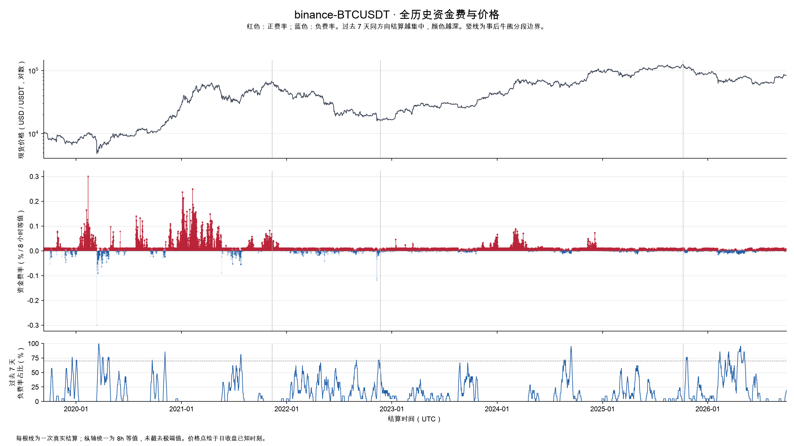
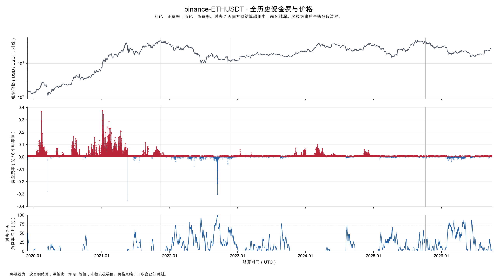
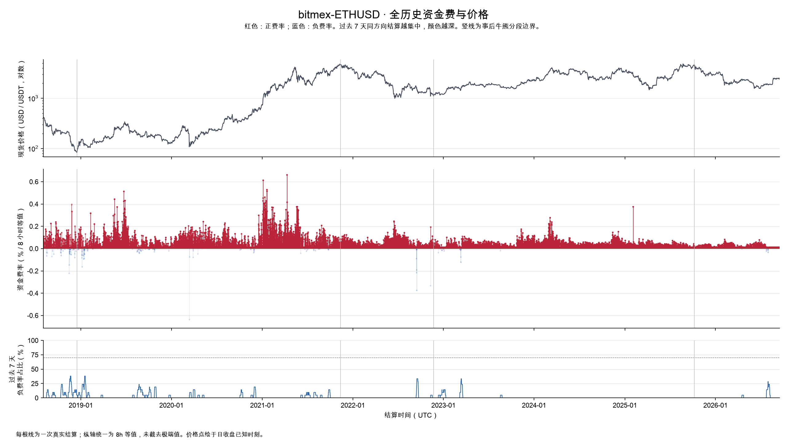
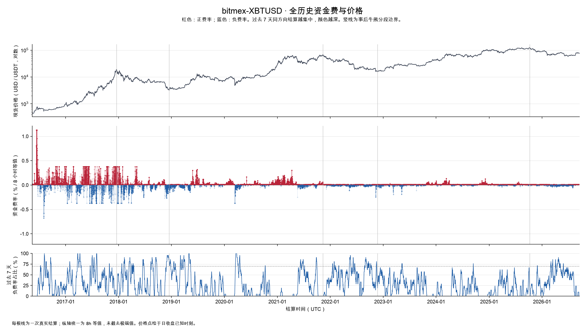

# BTC、ETH 全历史资金费：牛熊分段、集中价格与买入验证

创建于 2026-10-02

## 核心结论

持续负资金费可以提供逆向观察线索，但本次完整历史验证不能把它升级为跨币种、跨交易所都稳健的高胜率买点。BTC 部分样本后续表现较强，ETH 短期结果较弱；信号出现后仍可能经历很深的下跌。

2012 年有 BTC 价格记录，但没有本次研究对应的永续资金费记录。BTC 资金费最早实际取得 BitMEX 2016-05-14，ETH 最早取得 BitMEX 2018-08-02；币安 BTC/ETH 从 2019 年开始。不同交易所不拼接成一条伪连续费率，也不把缺失填成零。

[打开交互图表入口](./图表入口.html) · [TradingView 指标源码](./funding_concentration.pine) · [指标使用说明](./TradingView指标使用说明.md)

## 图表如何阅读

横轴是 UTC 时间，主纵轴是资金费率（百分数，统一为每 8 小时等值）。红色表示正费率、蓝色表示负费率。每个结算点的颜色深浅由截至当时过去 7 天内同号结算次数占比决定，占比越高越深；它不表示费率金额更高。早期不足 7 天的区域属于不完整窗口。

价格面板使用日收盘价：交互图采用线性纵轴，并按当前可见时间段的价格自动缩放、上下留 8% 余量；静态全历史图保留对数坐标。早期 BTC 使用 CoinMetrics 日参考价，之后用币安现货收盘。选择阶段、拖动时间滑块或框选放大时，交互价格纵轴同步调整；悬停可查看费率、同号占比和参考价格。灰色竖线是事后牛熊边界，不能实时预知。

## 数据范围与缺口

| 数据集 | 第一条 UTC | 最后一条 UTC | 结算数 | 周期小时:次数 |
| --- | --- | --- | --- | --- |
| binance-BTCUSDT | 2019-09-10T08:00:00+00:00 | 2026-10-01T16:00:00+00:00 | 7736 | {"8": 7736} |
| binance-ETHUSDT | 2019-11-27T08:00:00+00:00 | 2026-10-01T16:00:00+00:00 | 7502 | {"8": 7502} |
| bitmex-ETHUSD | 2018-08-02T12:00:00+00:00 | 2026-09-16T12:00:00+00:00 | 8902 | {"8.0": 8902} |
| bitmex-XBTUSD | 2016-05-14T12:00:00+00:00 | 2026-09-16T12:00:00+00:00 | 11290 | {"24.0": 22, "8.0": 11268} |

本次分析截止 2026-10-02 00:00 UTC，保留最后完整交易日。币安资金费内部网格完整。BitMEX 两合约接口最新只返回到 2026-09-16 12:00，各自尾部 46 个 8 小时时槽未获取；对应阶段占比的分母仅包含已获取记录，不声称覆盖完整尾部。

早期币安资金费记录缺少结算标记价（BTC 4536 条、ETH 4302 条），使用当时已经完成的上一 UTC 日现货收盘作价格代理。BitMEX 资金费接口不附带价格，同样匹配上一日收盘；BTC 在币安日线开始前使用上一 UTC 日 CoinMetrics 参考价。价格区间因此是粗略区域，不能当作每次结算的精确交易价格。

完整原始响应、规范记录和缺口检查见 [manifest.json](./manifest.json) 与 `raw/`。

BitMEX ETHUSD 另以四个日期独立查询各 3 条记录，12 条 `fundingRate` 与保存的小数费率全部一致，没有误用 `fundingRateDaily`。此为同一官方 API 不同参数交叉检查，不冒充独立归档源验证；证据见 `raw/bitmex-ETHUSD-sample-validation.json`。

BitMEX ETHUSD 必须单独解释：它是 USD 报价、BTC 保证金及盈亏结算的 quanto 合约，与币安 USDT 本位 ETHUSDT 不同。本次统计中其正费率占 98.53%，没有触发 7 天负费率 ≥70% 的规则。BitMEX 2018 年官方研究就讨论过 ETH 下跌但费率仍长期为正，以及 quanto 风险溢价与 ETH/BTC 相关性对定价的影响。这提供了结构性解释，但不能证明本次全历史的全部差异都由单一机制造成。[官方合约说明](https://www.bitmex.com/app/perpetualContractsGuide)；[官方 quanto 定价分析](https://www.bitmex.com/blog/is-the-ethusd-swap-fairly-priced)。

## 牛熊分段方式

在预先选定的主要周期年份中，使用币安 BTC 日线最高 high / 最低 low 查找大周期顶底。2017 年币安日线从 8 月 17 日开始，已覆盖 12 月峰值；2018、2021、2022、2025 年覆盖完整。ETH 沿用 BTC 周期以便比较，不等于 ETH 自己的最高点和最低点。

| 拐点 | UTC 日期 | BTC 价格（USDT） |
| --- | --- | --- |
| 2017_peak | 2017-12-17 | 19,798.68 |
| 2018_bottom | 2018-12-15 | 3,156.26 |
| 2021_peak | 2021-11-10 | 69,000.00 |
| 2022_bottom | 2022-11-21 | 15,476.00 |
| 2025_peak | 2025-10-06 | 126,199.63 |

拐点当日整体归入前一阶段，下一 UTC 日开始后一阶段，避免重复计数。首次覆盖是周期中途截入；最后阶段从 2025-10-07 至研究截止日，仅称高点后观察期，尚未确认完整熊市终点。长牛市阶段仍包含 2020 年 3 月、2021 年中等大幅回撤。

这一分段用于事后描述。买入信号的计算完全不引用顶底日期；阶段只用于事后分组及基线比较。

## 每个阶段的正负费率占比

次数占比是同号结算次数 / 全部结算次数；时长占比按每次实际结算周期小时数加权。两者都不是期内每秒预测费率的正负占比。阶段按结算时点归属，不拆分跨边界周期。

### binance-BTCUSDT

| 实际覆盖日期 | 阶段 | 次数 | 正次数占比 | 负次数占比 | 零占比 | 正时长占比 | 负时长占比 |
| --- | --- | --- | --- | --- | --- | --- | --- |
| 2019-09-10—2021-11-10 | 牛市 | 2378 | 87.51% | 12.49% | 0.00% | 87.51% | 12.49% |
| 2021-11-11—2022-11-21 | 熊市 | 1128 | 79.79% | 20.21% | 0.00% | 79.79% | 20.21% |
| 2022-11-22—2025-10-06 | 牛市 | 3150 | 90.00% | 10.00% | 0.00% | 90.00% | 10.00% |
| 2025-10-07—2026-10-01 | 高点后 / 未完 | 1080 | 76.11% | 23.89% | 0.00% | 76.11% | 23.89% |

[查看可缩放分段图](./charts/binance-BTCUSDT-interactive.html)

### binance-ETHUSDT

| 实际覆盖日期 | 阶段 | 次数 | 正次数占比 | 负次数占比 | 零占比 | 正时长占比 | 负时长占比 |
| --- | --- | --- | --- | --- | --- | --- | --- |
| 2019-11-27—2021-11-10 | 牛市 | 2144 | 96.50% | 3.50% | 0.00% | 96.50% | 3.50% |
| 2021-11-11—2022-11-21 | 熊市 | 1128 | 69.50% | 30.50% | 0.00% | 69.50% | 30.50% |
| 2022-11-22—2025-10-06 | 牛市 | 3150 | 89.87% | 10.13% | 0.00% | 89.87% | 10.13% |
| 2025-10-07—2026-10-01 | 高点后 / 未完 | 1080 | 73.52% | 26.48% | 0.00% | 73.52% | 26.48% |

[查看可缩放分段图](./charts/binance-ETHUSDT-interactive.html)

### bitmex-ETHUSD

| 实际覆盖日期 | 阶段 | 次数 | 正次数占比 | 负次数占比 | 零占比 | 正时长占比 | 负时长占比 |
| --- | --- | --- | --- | --- | --- | --- | --- |
| 2018-08-02—2018-12-15 | 熊市 | 407 | 92.63% | 7.37% | 0.00% | 92.63% | 7.37% |
| 2018-12-16—2021-11-10 | 牛市 | 3183 | 97.86% | 2.10% | 0.03% | 97.86% | 2.10% |
| 2021-11-11—2022-11-21 | 熊市 | 1128 | 99.29% | 0.71% | 0.00% | 99.29% | 0.71% |
| 2022-11-22—2025-10-06 | 牛市 | 3150 | 99.49% | 0.48% | 0.03% | 99.49% | 0.48% |
| 2025-10-07—2026-09-16 | 高点后 / 未完 | 1034 | 99.13% | 0.87% | 0.00% | 99.13% | 0.87% |

[查看可缩放分段图](./charts/bitmex-ETHUSD-interactive.html)

### bitmex-XBTUSD

| 实际覆盖日期 | 阶段 | 次数 | 正次数占比 | 负次数占比 | 零占比 | 正时长占比 | 负时长占比 |
| --- | --- | --- | --- | --- | --- | --- | --- |
| 2016-05-14—2017-12-17 | 牛市 | 1706 | 64.77% | 34.82% | 0.41% | 65.66% | 33.94% |
| 2017-12-18—2018-12-15 | 熊市 | 1089 | 61.07% | 38.84% | 0.09% | 61.07% | 38.84% |
| 2018-12-16—2021-11-10 | 牛市 | 3183 | 76.97% | 23.03% | 0.00% | 76.97% | 23.03% |
| 2021-11-11—2022-11-21 | 熊市 | 1128 | 55.50% | 44.41% | 0.09% | 55.50% | 44.41% |
| 2022-11-22—2025-10-06 | 牛市 | 3150 | 79.94% | 19.90% | 0.16% | 79.94% | 19.90% |
| 2025-10-07—2026-09-16 | 高点后 / 未完 | 1034 | 62.67% | 36.94% | 0.39% | 62.67% | 36.94% |

[查看可缩放分段图](./charts/bitmex-XBTUSD-interactive.html)

## 集中月份、价格区域和连续段

以下逐阶段列出正负各自出现次数最多的月份和价格箱。月份括号是该月同号次数，价格箱括号是占本阶段全部同号次数的比例；这些是事后分布，停留时间长也会增加次数。价格箱宽按该阶段价格中位数自动分档，左闭右开，不是人工挑选支撑位。

### binance-BTCUSDT

**2018-12-16—2021-11-10 牛市**

| 方向 | 最集中月份 | 集中价格箱（USD / USDT） | 最长连续段（UTC） |
| --- | --- | --- | --- |
| 正费率 | 2020-07（93 次）；2020-08（93 次）；2021-01（93 次） | 9,000—10,000（15.8%）；8,000—9,000（10.9%） | 2020-12-12T16:00—2021-05-19T08:00；474 次 / 折算 158.00 天 |
| 负费率 | 2020-03（42 次）；2021-07（42 次）；2020-04（37 次） | 7,000—8,000（21.9%）；6,000—7,000（15.2%） | 2020-03-12T16:00—2020-03-20T08:00；24 次 / 折算 8.00 天 |

**2021-11-11—2022-11-21 熊市**

| 方向 | 最集中月份 | 集中价格箱（USD / USDT） | 最长连续段（UTC） |
| --- | --- | --- | --- |
| 正费率 | 2021-12（91 次）；2022-07（88 次）；2022-10（85 次） | 20,000—25,000（25.6%）；40,000—45,000（17.1%） | 2021-11-11T00:00—2021-12-13T16:00；99 次 / 折算 33.00 天 |
| 负费率 | 2022-08（34 次）；2022-02（28 次）；2022-04（27 次） | 35,000—40,000（30.3%）；20,000—25,000（24.1%） | 2022-04-22T08:00—2022-04-25T08:00；10 次 / 折算 3.33 天 |

**2022-11-22—2025-10-06 牛市**

| 方向 | 最集中月份 | 集中价格箱（USD / USDT） | 最长连续段（UTC） |
| --- | --- | --- | --- |
| 正费率 | 2023-12（93 次）；2024-01（93 次）；2024-03（93 次） | 20,000—30,000（23.0%）；60,000—70,000（18.6%） | 2023-10-21T08:00—2024-04-18T08:00；541 次 / 折算 180.33 天 |
| 负费率 | 2024-08（37 次）；2023-09（33 次）；2024-09（30 次） | 20,000—30,000（32.1%）；50,000—60,000（16.8%） | 2024-09-08T08:00—2024-09-14T00:00；18 次 / 折算 6.00 天 |

**2025-10-07—2026-10-01 高点后观察期（底部未确认）**

| 方向 | 最集中月份 | 集中价格箱（USD / USDT） | 最长连续段（UTC） |
| --- | --- | --- | --- |
| 正费率 | 2026-08（93 次）；2026-07（92 次）；2026-01（89 次） | 60,000—70,000（32.2%）；70,000—80,000（23.1%） | 2026-07-23T08:00—2026-09-05T00:00；132 次 / 折算 44.00 天 |
| 负费率 | 2026-04（58 次）；2026-03（52 次）；2026-02（45 次） | 60,000—70,000（37.6%）；70,000—80,000（37.2%） | 2026-04-17T16:00—2026-04-22T00:00；14 次 / 折算 4.67 天 |

完整价格箱还同时提供箱内正负发生比例，见 `analysis.json` 的 `price_bins`。不能把“全部负费率有多少发生在这个价格”误解为“到这个价格有多大概率负费率”。

### binance-ETHUSDT

**2018-12-16—2021-11-10 牛市**

| 方向 | 最集中月份 | 集中价格箱（USD / USDT） | 最长连续段（UTC） |
| --- | --- | --- | --- |
| 正费率 | 2019-12（93 次）；2020-07（93 次）；2020-08（93 次） | 200—250（14.0%）；100—150（9.4%） | 2020-10-07T08:00—2021-05-19T08:00；673 次 / 折算 224.33 天 |
| 负费率 | 2021-06（18 次）；2021-07（15 次）；2020-10（8 次） | 150—200（13.3%）；100—150（10.7%） | 2021-06-26T08:00—2021-06-28T00:00；6 次 / 折算 2.00 天 |

**2021-11-11—2022-11-21 熊市**

| 方向 | 最集中月份 | 集中价格箱（USD / USDT） | 最长连续段（UTC） |
| --- | --- | --- | --- |
| 正费率 | 2021-12（89 次）；2022-03（81 次）；2022-07（73 次） | 1,500—1,750（13.4%）；1,250—1,500（12.6%） | 2021-11-11T00:00—2021-12-10T08:00；89 次 / 折算 29.67 天 |
| 负费率 | 2022-09（61 次）；2022-06（42 次）；2022-04（41 次） | 1,500—1,750（20.9%）；1,000—1,250（17.4%） | 2022-09-08T08:00—2022-09-16T08:00；25 次 / 折算 8.33 天 |

**2022-11-22—2025-10-06 牛市**

| 方向 | 最集中月份 | 集中价格箱（USD / USDT） | 最长连续段（UTC） |
| --- | --- | --- | --- |
| 正费率 | 2023-01（93 次）；2023-12（93 次）；2024-01（93 次） | 1,750—2,000（17.8%）；1,500—1,750（13.6%） | 2023-10-01T08:00—2024-04-21T00:00；609 次 / 折算 203.00 天 |
| 负费率 | 2025-04（37 次）；2024-08（33 次）；2025-03（28 次） | 1,500—1,750（23.8%）；1,750—2,000（22.3%） | 2024-08-05T00:00—2024-08-08T16:00；12 次 / 折算 4.00 天 |

**2025-10-07—2026-10-01 高点后观察期（底部未确认）**

| 方向 | 最集中月份 | 集中价格箱（USD / USDT） | 最长连续段（UTC） |
| --- | --- | --- | --- |
| 正费率 | 2026-08（88 次）；2026-07（86 次）；2026-01（84 次） | 1,750—2,000（20.0%）；2,000—2,250（14.6%） | 2026-05-15T08:00—2026-06-05T00:00；63 次 / 折算 21.00 天 |
| 负费率 | 2026-02（55 次）；2026-03（52 次）；2026-04（52 次） | 2,250—2,500（24.8%）；2,000—2,250（24.1%） | 2026-04-23T08:00—2026-04-28T08:00；16 次 / 折算 5.33 天 |

完整价格箱还同时提供箱内正负发生比例，见 `analysis.json` 的 `price_bins`。不能把“全部负费率有多少发生在这个价格”误解为“到这个价格有多大概率负费率”。

### bitmex-ETHUSD

**2017-12-18—2018-12-15 熊市**

| 方向 | 最集中月份 | 集中价格箱（USD / USDT） | 最长连续段（UTC） |
| --- | --- | --- | --- |
| 正费率 | 2018-09（87 次）；2018-08（86 次）；2018-10（85 次） | 200—225（30.0%）；275—300（14.3%） | 2018-09-14T12:00—2018-10-11T12:00；82 次 / 折算 27.33 天 |
| 负费率 | 2018-11（12 次）；2018-10（8 次）；2018-12（4 次） | 175—200（40.0%）；200—225（23.3%） | 2018-11-11T04:00—2018-11-11T12:00；2 次 / 折算 0.67 天 |

**2018-12-16—2021-11-10 牛市**

| 方向 | 最集中月份 | 集中价格箱（USD / USDT） | 最长连续段（UTC） |
| --- | --- | --- | --- |
| 正费率 | 2019-05（93 次）；2020-01（93 次）；2020-07（93 次） | 125—150（11.3%）；150—175（9.4%） | 2020-11-29T20:00—2021-06-04T20:00；562 次 / 折算 187.33 天 |
| 负费率 | 2019-01（15 次）；2019-08（9 次）；2019-10（7 次） | 150—175（23.9%）；100—125（16.4%） | 2019-01-06T04:00—2019-01-06T20:00；3 次 / 折算 1.00 天 |

**2021-11-11—2022-11-21 熊市**

| 方向 | 最集中月份 | 集中价格箱（USD / USDT） | 最长连续段（UTC） |
| --- | --- | --- | --- |
| 正费率 | 2021-12（93 次）；2022-01（93 次）；2022-03（93 次） | 1,500—1,750（15.2%）；1,250—1,500（13.9%） | 2021-11-11T04:00—2022-09-12T20:00；918 次 / 折算 306.00 天 |
| 负费率 | 2022-09（7 次）；2022-11（1 次） | 1,500—1,750（87.5%）；1,000—1,250（12.5%） | 2022-09-14T04:00—2022-09-15T20:00；6 次 / 折算 2.00 天 |

**2022-11-22—2025-10-06 牛市**

| 方向 | 最集中月份 | 集中价格箱（USD / USDT） | 最长连续段（UTC） |
| --- | --- | --- | --- |
| 正费率 | 2023-05（93 次）；2023-07（93 次）；2023-10（93 次） | 1,750—2,000（18.4%）；1,500—1,750（14.6%） | 2023-08-18T20:00—2025-02-03T12:00；1605 次 / 折算 535.00 天 |
| 负费率 | 2023-03（7 次）；2022-12（4 次）；2023-01（3 次） | 1,000—1,250（40.0%）；1,250—1,500（33.3%） | 2023-03-11T12:00—2023-03-12T12:00；4 次 / 折算 1.33 天 |

**2025-10-07—2026-10-01 高点后观察期（底部未确认）**

| 方向 | 最集中月份 | 集中价格箱（USD / USDT） | 最长连续段（UTC） |
| --- | --- | --- | --- |
| 正费率 | 2025-12（93 次）；2026-01（93 次）；2026-03（93 次） | 1,750—2,000（21.2%）；2,000—2,250（17.6%） | 2025-10-07T04:00—2026-04-17T04:00；577 次 / 折算 192.33 天 |
| 负费率 | 2026-07（6 次）；2026-08（2 次）；2026-04（1 次） | 1,750—2,000（88.9%）；2,250—2,500（11.1%） | 2026-07-25T04:00—2026-07-25T20:00；3 次 / 折算 1.00 天 |

完整价格箱还同时提供箱内正负发生比例，见 `analysis.json` 的 `price_bins`。不能把“全部负费率有多少发生在这个价格”误解为“到这个价格有多大概率负费率”。

### bitmex-XBTUSD

**2016-05-14—2017-12-17 牛市**

| 方向 | 最集中月份 | 集中价格箱（USD / USDT） | 最长连续段（UTC） |
| --- | --- | --- | --- |
| 正费率 | 2016-10（82 次）；2016-12（78 次）；2016-11（74 次） | 600—700（19.9%）；700—800（12.9%） | 2016-05-14T12:00—2016-06-19T04:00；66 次 / 折算 36.67 天 |
| 负费率 | 2016-08（60 次）；2017-07（58 次）；2017-04（54 次） | 600—700（14.0%）；500—600（10.8%） | 2017-07-26T04:00—2017-08-03T20:00；27 次 / 折算 9.00 天 |

**2017-12-18—2018-12-15 熊市**

| 方向 | 最集中月份 | 集中价格箱（USD / USDT） | 最长连续段（UTC） |
| --- | --- | --- | --- |
| 正费率 | 2018-10（85 次）；2018-07（80 次）；2018-05（77 次） | 6,000—7,000（37.3%）；7,000—8,000（18.2%） | 2018-10-17T20:00—2018-11-14T20:00；85 次 / 折算 28.33 天 |
| 负费率 | 2018-08（51 次）；2018-02（50 次）；2018-03（48 次） | 6,000—7,000（40.7%）；8,000—9,000（11.1%） | 2018-11-25T12:00—2018-12-01T20:00；20 次 / 折算 6.67 天 |

**2018-12-16—2021-11-10 牛市**

| 方向 | 最集中月份 | 集中价格箱（USD / USDT） | 最长连续段（UTC） |
| --- | --- | --- | --- |
| 正费率 | 2020-12（93 次）；2021-03（93 次）；2020-01（92 次） | 9,000—10,000（15.6%）；8,000—9,000（10.7%） | 2021-01-28T20:00—2021-04-18T04:00；239 次 / 折算 79.67 天 |
| 负费率 | 2019-03（71 次）；2021-06（63 次）；2019-01（59 次） | 3,000—4,000（22.1%）；5,000—6,000（10.8%） | 2020-03-12T20:00—2020-03-26T12:00；42 次 / 折算 14.00 天 |

**2021-11-11—2022-11-21 熊市**

| 方向 | 最集中月份 | 集中价格箱（USD / USDT） | 最长连续段（UTC） |
| --- | --- | --- | --- |
| 正费率 | 2022-07（65 次）；2021-12（62 次）；2022-03（59 次） | 20,000—25,000（26.7%）；40,000—45,000（17.1%） | 2021-11-20T20:00—2021-12-04T12:00；42 次 / 折算 14.00 天 |
| 负费率 | 2022-09（61 次）；2022-05（56 次）；2022-06（56 次） | 20,000—25,000（23.6%）；15,000—20,000（20.6%） | 2022-06-01T20:00—2022-06-06T20:00；16 次 / 折算 5.33 天 |

**2022-11-22—2025-10-06 牛市**

| 方向 | 最集中月份 | 集中价格箱（USD / USDT） | 最长连续段（UTC） |
| --- | --- | --- | --- |
| 正费率 | 2024-03（93 次）；2023-12（92 次）；2023-11（90 次） | 20,000—30,000（20.8%）；60,000—70,000（19.4%） | 2024-10-11T20:00—2024-12-21T12:00；213 次 / 折算 71.00 天 |
| 负费率 | 2022-12（46 次）；2025-03（42 次）；2023-05（41 次） | 20,000—30,000（36.2%）；60,000—70,000（12.8%） | 2023-05-05T12:00—2023-05-09T20:00；14 次 / 折算 4.67 天 |

**2025-10-07—2026-10-01 高点后观察期（底部未确认）**

| 方向 | 最集中月份 | 集中价格箱（USD / USDT） | 最长连续段（UTC） |
| --- | --- | --- | --- |
| 正费率 | 2026-08（79 次）；2026-01（74 次）；2025-11（72 次） | 60,000—70,000（29.2%）；70,000—80,000（24.1%） | 2025-10-30T20:00—2025-11-19T12:00；60 次 / 折算 20.00 天 |
| 负费率 | 2026-04（64 次）；2026-05（55 次）；2026-06（51 次） | 60,000—70,000（44.8%）；70,000—80,000（31.9%） | 2026-03-09T04:00—2026-03-13T12:00；14 次 / 折算 4.67 天 |

完整价格箱还同时提供箱内正负发生比例，见 `analysis.json` 的 `price_bins`。不能把“全部负费率有多少发生在这个价格”误解为“到这个价格有多大概率负费率”。

## 负费率集中之后，买入结果怎样

规则在批量分析前固定：过去 7 天已结算记录中，负费率次数占比 ≥70%，且当前费率为负；下一 UTC 日现货开盘买入。信号按时间顺序取首次触发，之后 90 天不再入场。每个事件分别持有 7、30、90 天，在第 N 天收盘退出。主表只使用未来 90 天价格完整的事件，三个期限使用同一批样本。

这是无杠杆现货事件研究，未计手续费和滑点，也没有把资金费收入算进收益。最大不利波动 MAE = 持有期内最低价 / 入场价 - 1（最多为 0），是相对买入价的最深下跌，不是收益曲线回撤。

对照包含两个口径：同数据源同期所有可入场日期的基线；再按信号所处牛熊阶段的权重重算基线。后者减少牛熊样本构成差异，但依然是事后描述，不是因果证明。基线日期的持有窗口重叠，不能把数千个日期视作数千次独立试验。不同交易所 BTC 信号共享同一市场，也不是独立实验。

| 数据源 | 完整事件数 | 30日均收益 | 30日上涨率 | 90日均收益 | 90日上涨率 | 同阶段基线90日 | 最差90日MAE |
| --- | --- | --- | --- | --- | --- | --- | --- |
| binance-BTCUSDT | 8 | +14.12% | +75.00% | +36.80% | +62.50% | +15.15% | -48.03% |
| binance-ETHUSDT | 7 | -7.50% | +28.57% | +9.35% | +71.43% | -5.93% | -35.95% |
| bitmex-ETHUSD | 0 | 无可评估样本 | 无可评估样本 | 无可评估样本 | 无可评估样本 | 无可评估样本 | 无可评估样本 |
| bitmex-XBTUSD | 17 | +12.96% | +64.71% | +33.83% | +64.71% | +10.61% | -50.25% |

结果支持把集中负费率作为候选观察条件，尚不支持只靠它机械买入。尤其币安 ETH 的 30 日平均收益为负，且弱于同阶段基线。BTC 均值较强，也不能消除深度套牢风险。样本数很少，门槛未做独立样本外测试；本研究开始前已看过部分 2025—2026 数据，因此不能称为严格盲测。

### 各阶段的验证结果

**binance-BTCUSDT**

| 阶段 | 事件数 | 90日均收益 | 90日上涨率 | 最差MAE |
| --- | --- | --- | --- | --- |
| 2018-12-16—2021-11-10 牛市 | 4 | +63.18% | 75.00% | -48.03% |
| 2021-11-11—2022-11-21 熊市 | 1 | -17.99% | 0.00% | -22.81% |
| 2022-11-22—2025-10-06 牛市 | 1 | +53.29% | 100.00% | -10.95% |
| 2025-10-07—2026-10-01 高点后观察期（底部未确认） | 2 | +3.18% | 50.00% | -24.80% |

**binance-ETHUSDT**

| 阶段 | 事件数 | 90日均收益 | 90日上涨率 | 最差MAE |
| --- | --- | --- | --- | --- |
| 2018-12-16—2021-11-10 牛市 | 0 | 无样本 | 无样本 | 无样本 |
| 2021-11-11—2022-11-21 熊市 | 3 | +3.57% | 66.67% | -31.81% |
| 2022-11-22—2025-10-06 牛市 | 2 | +23.27% | 100.00% | -15.84% |
| 2025-10-07—2026-10-01 高点后观察期（底部未确认） | 2 | +4.11% | 50.00% | -35.95% |

**bitmex-ETHUSD**

| 阶段 | 事件数 | 90日均收益 | 90日上涨率 | 最差MAE |
| --- | --- | --- | --- | --- |
| 2017-12-18—2018-12-15 熊市 | 0 | 无样本 | 无样本 | 无样本 |
| 2018-12-16—2021-11-10 牛市 | 0 | 无样本 | 无样本 | 无样本 |
| 2021-11-11—2022-11-21 熊市 | 0 | 无样本 | 无样本 | 无样本 |
| 2022-11-22—2025-10-06 牛市 | 0 | 无样本 | 无样本 | 无样本 |
| 2025-10-07—2026-10-01 高点后观察期（底部未确认） | 0 | 无样本 | 无样本 | 无样本 |

**bitmex-XBTUSD**

| 阶段 | 事件数 | 90日均收益 | 90日上涨率 | 最差MAE |
| --- | --- | --- | --- | --- |
| 2016-05-14—2017-12-17 牛市 | 1 | +87.36% | 100.00% | -13.17% |
| 2017-12-18—2018-12-15 熊市 | 4 | -2.42% | 50.00% | -50.25% |
| 2018-12-16—2021-11-10 牛市 | 5 | +98.18% | 100.00% | -14.16% |
| 2021-11-11—2022-11-21 熊市 | 3 | -15.57% | 0.00% | -39.30% |
| 2022-11-22—2025-10-06 牛市 | 2 | +35.52% | 100.00% | -10.24% |
| 2025-10-07—2026-10-01 高点后观察期（底部未确认） | 2 | -8.88% | 50.00% | -33.92% |

### 全部信号明细

缺少未来足够价格的尾部事件明确列为未满窗口，不填零。入场价格和结果均来自币安对应现货；BitMEX 2017-08-17 以前没有相同 OHLC，未伪造早期回测。

**binance-BTCUSDT**

| 入场日期UTC | 价格 | 7日收益 | 30日收益 | 90日收益 | 90日MAE |
| --- | --- | --- | --- | --- | --- |
| 2019-12-19 | 7,277.83 | -1.01% | +22.47% | -27.00% | -48.03% |
| 2020-03-18 | 5,312.64 | +26.96% | +33.68% | +77.43% | -5.71% |
| 2020-09-22 | 10,417.22 | +2.68% | +22.69% | +125.16% | -2.69% |
| 2021-07-25 | 34,261.51 | +21.02% | +44.44% | +77.13% | -1.20% |
| 2022-09-01 | 20,048.44 | -3.77% | -3.12% | -17.99% | -22.81% |
| 2024-08-21 | 59,013.80 | +0.68% | +6.67% | +53.29% | -10.95% |
| 2025-10-19 | 107,185.00 | +4.16% | -13.97% | -10.85% | -24.80% |
| 2026-02-10 | 70,138.00 | -1.78% | +0.08% | +17.21% | -10.88% |

**binance-ETHUSDT**

| 入场日期UTC | 价格 | 7日收益 | 30日收益 | 90日收益 | 90日MAE |
| --- | --- | --- | --- | --- | --- |
| 2022-02-02 | 2,787.48 | +11.81% | +1.67% | +2.48% | -17.49% |
| 2022-06-16 | 1,237.53 | -15.14% | -0.51% | +27.22% | -28.76% |
| 2022-09-14 | 1,574.40 | -15.97% | -18.25% | -18.99% | -31.81% |
| 2023-08-25 | 1,661.16 | -0.93% | -4.05% | +24.20% | -8.44% |
| 2024-08-12 | 2,555.38 | +2.22% | -6.53% | +22.34% | -15.84% |
| 2026-02-06 | 1,826.83 | +6.62% | +7.81% | +28.68% | -4.33% |
| 2026-05-07 | 2,350.84 | -3.92% | -32.65% | -20.46% | -35.95% |

**bitmex-ETHUSD**

| 入场日期UTC | 价格 | 7日收益 | 30日收益 | 90日收益 | 90日MAE |
| --- | --- | --- | --- | --- | --- |

**bitmex-XBTUSD**

| 入场日期UTC | 价格 | 7日收益 | 30日收益 | 90日收益 | 90日MAE |
| --- | --- | --- | --- | --- | --- |
| 2017-10-30 | 6,133.01 | +19.76% | +61.37% | +87.36% | -13.17% |
| 2018-02-07 | 7,655.02 | +11.56% | +21.12% | +22.34% | -16.00% |
| 2018-06-17 | 6,482.50 | -5.13% | +3.72% | -0.09% | -11.30% |
| 2018-09-15 | 6,476.63 | +4.36% | -2.12% | -49.02% | -50.25% |
| 2018-12-14 | 3,302.06 | +22.64% | +8.51% | +17.08% | -4.42% |
| 2019-03-14 | 3,866.00 | +4.58% | +30.57% | +103.95% | -1.44% |
| 2020-03-18 | 5,312.64 | +26.96% | +33.68% | +77.43% | -5.71% |
| 2020-10-09 | 10,925.44 | +5.31% | +35.63% | +236.55% | -0.88% |
| 2021-06-08 | 33,556.96 | +20.74% | +0.91% | +54.24% | -14.16% |
| 2021-09-25 | 42,810.58 | +12.45% | +42.14% | +18.75% | -4.81% |
| 2022-01-17 | 43,071.66 | -15.85% | +3.42% | -6.25% | -23.58% |
| 2022-05-13 | 29,029.74 | +4.44% | -2.08% | -17.48% | -39.30% |
| 2022-08-26 | 21,559.04 | -6.62% | -12.24% | -22.99% | -28.22% |
| 2023-05-10 | 27,628.28 | -2.15% | -4.09% | +5.73% | -10.24% |
| 2024-09-14 | 60,497.99 | +4.47% | +3.92% | +65.30% | -4.97% |
| 2025-11-30 | 90,802.44 | -1.72% | -3.93% | -27.46% | -33.92% |
| 2026-03-01 | 66,973.26 | +0.43% | -0.26% | +9.69% | -2.95% |

## TradingView 自定义指标

[funding_concentration.pine](./funding_concentration.pine) 为 Pine Script v6，默认读取 TradingView 官方支持的永续资金费数据流，7 天 =21 个已确认的 8 小时样本。红正蓝负，同号越集中颜色越深。它不把历史顶底当作实时信号，也没有依据本次回测在图上画买卖箭头。

建议先在 `BINANCE:BTCUSDT.P` 的 8 小时普通 K 线图中测试：Pine Editor → 新建指标 → 粘贴源码 → 添加到图表。ETH 在设置里切换合约即可。日线会漏掉日内采样，因此脚本明确要求日内周期。读取上一根已确认数据，柱子相应延后一个采样周期，不回填。

已核验官方 Request 库的 `_FR` 数据命名与百分数单位，并完成静态检查；尚未在 TradingView 在线编译和核对实际账户的数据权限。数据流的已确认采样未必逐条等于交易所最终结算率，因此其显示与本报告可能不完全一致。细节与兼容模式见使用说明。

图表验证：静态 PNG 已生成并目视检查，分段计数、7 天滚动窗口、日期对齐已复核。浏览器安全策略拒绝自动访问本机预览页，因此 HTML 的交互操作尚未在浏览器中实机验证；图表文件采用本地 Plotly 依赖，不依赖在线 CDN。

## 复现与一手来源

1. `python3 collect_data.py`：读取公开 API，保留原始响应与规范数据；不会读取私有账户。
2. `python3 analyze_history.py`：阶段分布、7天集中度规则和后续收益验证。
3. 安装标准绘图库 `matplotlib plotly` 后运行 `python3 plot_history.py`；运行 `python3 build_report.py` 更新本报告。macOS 字体路径在绘图脚本中。
4. [分段汇总 CSV](./phase-summary.csv)、[全部信号 CSV](./signal-events.csv)、[完整分析 JSON](./analysis.json)。

- [币安历史资金费与市场数据文档](https://developers.binance.com/en/docs/catalog/core-trading-derivatives-trading-usd-s-m-futures/api/rest-api/market-data)
- [币安现货日线文档](https://developers.binance.com/docs/binance-spot-api-docs/rest-api/market-data-endpoints)
- [BitMEX 资金费历史 API](https://docs.bitmex.com/api-explorer/get-funding.html)
- [BitMEX 永续产品发布公告](https://www.bitmex.com/blog/announcing-the-launch-of-the-perpetual-xbtusd-leveraged-swap)
- [CoinMetrics 日度参考价时间定义](https://github.com/coinmetrics/docs-website/blob/master/asset-metrics/market/priceusd.md)
- [TradingView 官方 Request 库](https://www.tradingview.com/script/Rpmobpw5-Request/)

使用的 skill：research。
